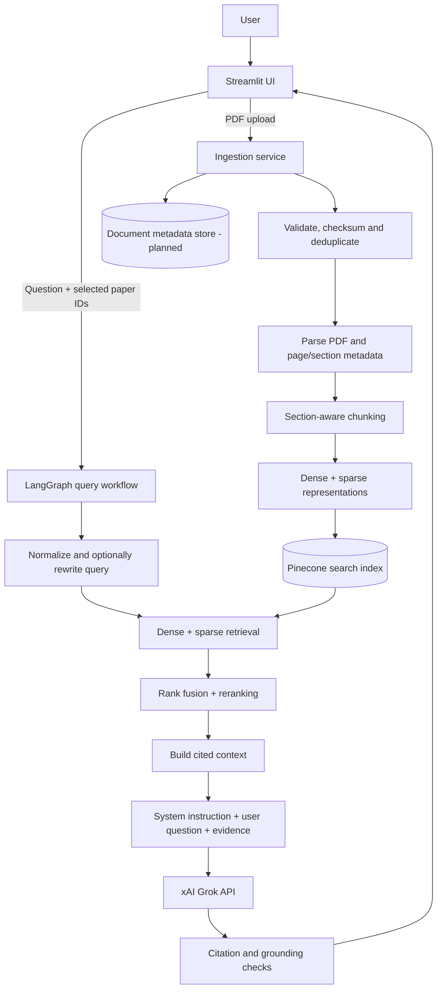

# ResearchMind AI

> Ask research questions. Get evidence-grounded answers with paper and page citations.

**Status:** Phase 1 — repository and dependency scaffolding. **The actual ingestion, retrieval, Grok integration and citation validation are not yet implemented.**

ResearchMind AI is a portfolio-oriented, production-style Retrieval-Augmented Generation (RAG) application for scientific research papers. Users will upload PDF papers and ask natural-language questions grounded in those papers.

## Tech stack

| Layer | Technology | Purpose |
|---|---|---|
| UI | Streamlit | PDF upload, paper library, chat, source citations |
| Language/runtime | Python 3.11 | Services and pipelines |
| RAG primitives | LangChain | Documents, splitting, integration helpers |
| Orchestration | LangGraph | Explicit query state graph |
| LLM | xAI Grok (API) | Answer generation (requires an API key and applicable usage quota/billing) |
| Dense embeddings | Sentence Transformers | Local query + document embeddings |
| Vector search | Pinecone | Managed semantic vector search and metadata filtering |
| Sparse retrieval | BM25 / Pinecone sparse support (final design in Phase 6) | Exact keyword and acronym matching |
| Fusion & ranking | RRF + cross-encoder reranker (planned) | Combine and prioritize relevant chunks |
| PDF parser | PyMuPDF | Page-level extraction, text, document metadata |
| Config/logs | pydantic-settings, structlog | Safe settings and observable logs |
| Quality | pytest, Ruff, GitHub Actions | Tests and CI |
| Hosting | Streamlit Community Cloud (initial target) | Share working demo; resource limits apply |

Grok from xAI and Groq are different platforms. xAI API access is separate from consumer Grok chat; check your account's model access and pricing. Secrets must be configured in the deployment environment.

## System architecture



**Architecture note:** Ingestion is a separate service/pipeline; the interactive query path uses LangGraph. The hybrid Pinecone index schema and sparse method will be chosen and benchmarked in Phase 6, rather than hardcoded at project setup.

## End-to-end flow

### A. Document ingestion (Phases 3–4)

1. User uploads one or more scientific PDF papers through Streamlit.
2. Validate file type/size/pages and reject invalid or encrypted/unreadable input gracefully.
3. Calculate a SHA-256 checksum for idempotent re-ingestion and document identity.
4. Parse full text page by page, retaining title/DOI (when available), page number, section heading and source filename.
5. Normalize text; use token-aware or section-aware chunking with controlled overlap.
6. Embed chunks locally; compute a sparse/keyword representation for hybrid retrieval.
7. Batch upsert chunk IDs, vectors and citation metadata to Pinecone, using an appropriate index schema.
8. Track ingestion success, failure and document-level status. Never embed or log credentials.

### B. Question answering (Phases 5–7)

1. User selects research papers (or entire library) and asks a question.
2. Normalize/optionally rewrite a conversational follow-up into a standalone retrieval query.
3. Generate query embedding using **the same embedding model** used for documents.
4. Apply document access and metadata filters, then retrieve dense and sparse candidates.
5. Combine results using Reciprocal Rank Fusion (RRF), deduplicate and rerank top candidates.
6. Enforce a context-token budget and preserve paper/page/chunk source IDs.
7. Assemble **system instructions + retrieved evidence + user question**; tell the LLM to treat retrieved PDF text as untrusted evidence, not as instructions.
8. Call Grok with bounded retries/timeouts and configurable model/settings.
9. Check citation references against retrieved sources. If evidence is insufficient, say so rather than fabricate a result.
10. Display answer with traceable source excerpts, document titles and page numbers in Streamlit.

## Production-style objectives

- Clear separation of UI, ingestion, retrieval and generation modules
- Repeatable ingestion; stable document/chunk IDs; metadata filtering
- Observable errors, safe secrets handling, bounded document sizes
- Retrieval evaluation (Recall@k, MRR, nDCG) and answer/citation evaluation
- Unit tests, integration tests, code formatting and CI
- Deployment secrets, cost/resource budgets and basic rate limits
- Scientific caution: PDF extraction, tables and equations can be imperfect, so cite and verify source snippets

> A personal Streamlit demo can follow production engineering practices without claiming enterprise-grade scale or availability.

## Roadmap

| Phase | Deliverable |
|---|---|
| 1 | Repo, virtual environment, dependency definitions, module placeholders |
| 2 | Streamlit upload/library/chat UI (mock responses first) |
| 3 | Validated scientific PDF ingestion |
| 4 | Chunking, embeddings and Pinecone indexing |
| 5 | Question processing and document filtering |
| 6 | Hybrid search, fusion and reranking |
| 7 | LangGraph pipeline, Grok integration and grounded citations |
| 8 | Tests, evaluation, CI, Docker and deployment |

## Folder overview

```text
app/
  config/       # app settings, logging
  domain/       # document, chunk and query data types
  ingestion/    # validation, PDF loader, parser, splitter
  embeddings/   # embedding service and Pinecone adapter
  retrieval/    # query processor, hybrid search, fusion, reranker
  generation/   # Grok client factory, prompts, grounding/citations
  workflows/    # LangGraph Q&A graph
  services/     # orchestration endpoints for UI
  ui/           # Streamlit frontend
  utils/        # shared helpers
scripts/        # developer operations
examples/       # non-sensitive example files (future)
tests/          # automated tests
data/           # ignored local uploads
.github/workflows/  # CI (future)
```

## Quickstart (Windows PowerShell)

```powershell
cd path\to\researchmind-ai
py -3.11 -m venv .venv
.\.venv\Scripts\Activate.ps1
python -m pip install --upgrade pip
python -m pip install -e ".[dev]"
Copy-Item .env.example .env  # skip if a local .env already exists
python -m streamlit run app/ui/streamlit_app.py
```

On macOS/Linux use `python3.11 -m venv .venv` and `source .venv/bin/activate`. Streamlit currently displays a Phase 1 welcome page. You do not need API keys to run it.

### Configuration

Copy `.env.example` to `.env`; set `XAI_API_KEY`, an accessible `XAI_MODEL`, and `PINECONE_API_KEY` when later phases require them. `.env` is excluded by `.gitignore`. For cloud deployment, store secrets in the hosting platform's secrets management, not Git.

`requirements.txt` delegates to `pyproject.toml` (`-e .`) so dependencies have one source of truth. Exact reproducible dependency pins/lockfile should be generated and tested before deployment.

## GitHub setup from an existing local folder

Create an **empty**, private or public repository named `researchmind-ai` on GitHub; do not select "Add README", `.gitignore`, or license there if those files exist locally.

```powershell
cd path\to\researchmind-ai
git init
git branch -M main
git add .
git status  # verify .env and data files are absent
git commit -m "chore: initialize ResearchMind AI scaffold"
git remote add origin https://github.com/YOUR_USERNAME/researchmind-ai.git
git push -u origin main
```

If `origin` already exists: `git remote set-url origin <repo-url>`. GitHub HTTPS pushes require browser sign-in, credential manager or a personal access token (not a GitHub account password). You can also use SSH if configured.

## License and disclaimer

Licensing is not yet selected. Do not distribute copyrighted PDF uploads without permission. Generated answers are for research assistance; verify claims against cited originals.
